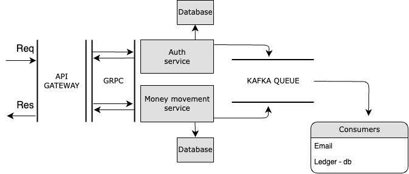
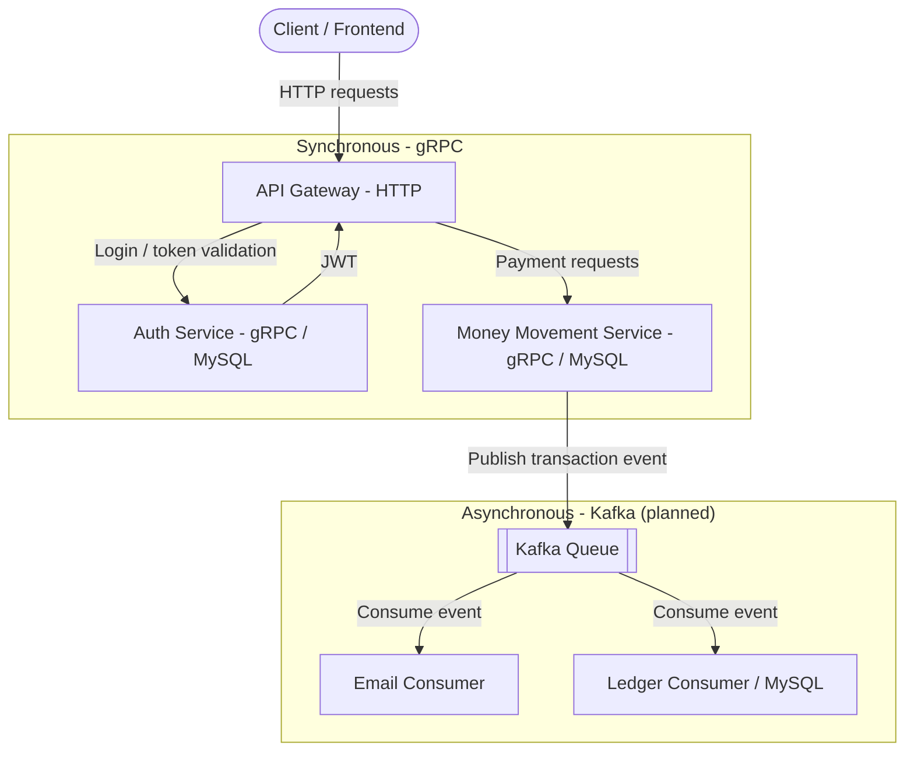

<h1 align="center">
Payment gateway

</h1>

<h4 align="center">Go · gRPC · Protocol Buffers · MySQL</h4>

This project models a barcode based payment flow: a merchant scans a customer’s code to start a payment. The backend is designed to check and record transfers between app wallets, then notify the customer. It demonstrates Go microservices and does not connect to banks or move real world funds.

## Intended transaction flow

The event service coordinates the steps. Services publish events to a broker topic, and interested services subscribe to that topic so they can react without the coordinator calling each one directly.

### High-level architecture

This is the original high-level view of the gateway, auth, money movement, and downstream consumers. It describes the intended architecture; Kafka and the consumer services are not implemented in the current repository.





### Transaction steps

1. The client requests a transfer through the API gateway.
2. The transaction service records it as **pending** and starts the workflow by publishing an event.
3. The balance service checks whether the sender has enough funds. If not, the workflow is marked failed; if so, it continues.
4. The transfer service performs the modeled transfer. On success, balances and transaction status are updated; on failure, the workflow is cancelled or marked failed.
5. After completion or failure, a notification event can trigger an email or other customer update.

Events are delivered through a broker topic. Services subscribe to the events they need, so the sender does not have to call every downstream service directly. A **dead-letter queue (DLQ)** holds messages that still fail after retries, for later investigation. Tracing and metrics help follow a transaction across services; a secret manager such as **Vault** can provide signing keys and other secrets.

## Services and authentication

- **API gateway:** Intended client entry point. The current HTTP handlers are placeholders.
- **Auth service:** Implemented as a gRPC service. It checks login credentials against MySQL, issues a signed JWT, and validates tokens. The token currently identifies the user and expires after 24 hours; role-based permissions are not defined here.
- **Money movement:** The SQL setup models wallets, accounts, and transaction records. The transfer workflow and event consumers are not implemented yet.
- **Event, notification, tracing, and secret-management components:** Part of the intended design; not yet present as working services in this repository.

The intended login flow is: credentials go to the auth service; valid credentials receive a JWT. For later protected requests, the gateway sends the JWT for validation. The current gateway does not yet enforce endpoint permissions. The sample auth query compares the supplied password directly with the database value; a production system should store a salted password hash instead. Do not send passwords in URL query parameters, and use HTTPS for client-facing requests.

## Stack

- **Go** for the services
- **gRPC and Protocol Buffers** for typed service contracts and internal calls
- **MySQL** for auth data and the planned wallet/transaction records
- **Event broker** for the planned asynchronous workflow (the specific broker is not configured in the current code)

## Generate the auth gRPC code

Install the Protocol Buffers compiler and Go plugins:

```sh
brew install protobuf
go install google.golang.org/protobuf/cmd/protoc-gen-go@v1.28
go install google.golang.org/grpc/cmd/protoc-gen-go-grpc@v1.2
```

Make sure Go's binary directory is on your `PATH` so `protoc` can find the plugins:

```sh
echo "$(go env GOPATH)/bin"
echo "$PATH"
```

If needed, add `export PATH="$(go env GOPATH)/bin:$PATH"` to `~/.zshrc`, then reload it with `source ~/.zshrc`.

From the repository root, generate the files:

```sh
cd src/gomicro/auth
protoc --go_out=. --go_opt=paths=source_relative --go-grpc_out=. --go-grpc_opt=paths=source_relative proto/auth_svc.proto
```

This generates `proto/auth_svc.pb.go` (message types and serialization code) and `proto/auth_svc_grpc.pb.go` (gRPC client/server code). These generated files should be regenerated when the `.proto` contract changes.
