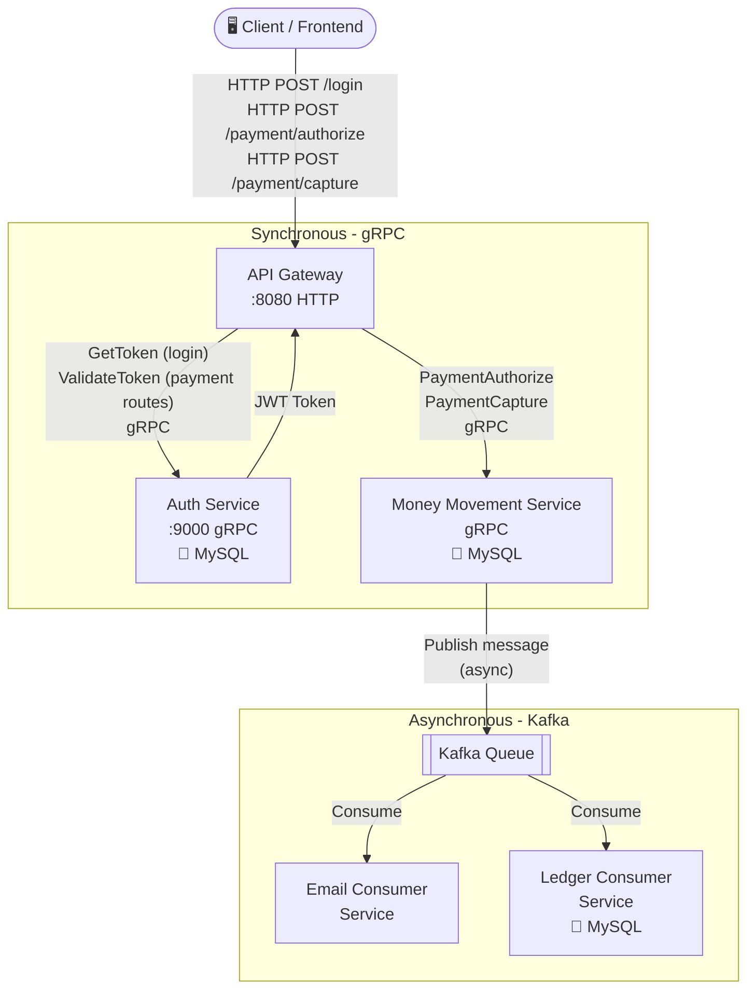
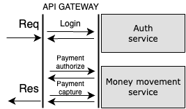

<h1 align="center">
Payment gateway

</h1>

<h4 align="center">Golang/Grpc/Kubernetes/MySQL</h4>

Simplifies transactions between merchants and customers. The process begins when a customer wants to make a payment. Instead of the traditional method of handing over cash or swiping a card, the application leverages the power of barcodes. The merchant will simply scan a barcode presented by the customer and the payment will be instantly processed. No need for physical currency or complex card machines - the entire transaction is handled digitally and securely.

    
    

By adopting a microservice architecture, the payment application becomes incredibly flexible, scalable, and maintainable. Each step of the payment process is broken down into smaller, independent services that are responsible for specific tasks. The money movement service is responsible for each transaction, while another service handles authentication and security. These services communicate with each other through gRPC.

        

        
        

    

        <h3>Services</h3>
        <ul>
            <li>
            <b>API Gateway service:</b> Communicates with interal services - both money movement and auth. Synchronous flows (api gateway to/from money movement and to/from auth) is done via gRPC. Gateway service - entry point of the micro service. </li>
             
            <li><b>Money movement service:</b> Indirectly (asynchronously) communicates with the 2 consumers: email and ledger. Money movement (storing the movement of the money) - contains a database. Shows customer to merchant and merchant back to customer incase of refunds etc money movement in a table.</li>
              
            <li><b>Kafka queue:</b> Async portion of the architecture. We don’t want the money movement service to wait on the processing of the email and ledger services, so the money movement service is placed on a message queue. After its put on a queue, the money movement service doesn’t have to think about what’s happening downstream anymore. It can immediately return the response back to the gateway and the gateway will return the response to the client.</li>
              
            <li><b>2 Consumer services:</b> email and ledger(contains database).</li>
            <li>Email/Ledger services: Sends an email to the user with payment complete/failed and the ledger service consumes the message and persists to a ledger db which can be used for the accounting department etc to keep records of payments/accounting stuff.</li>
        </ul>
    

